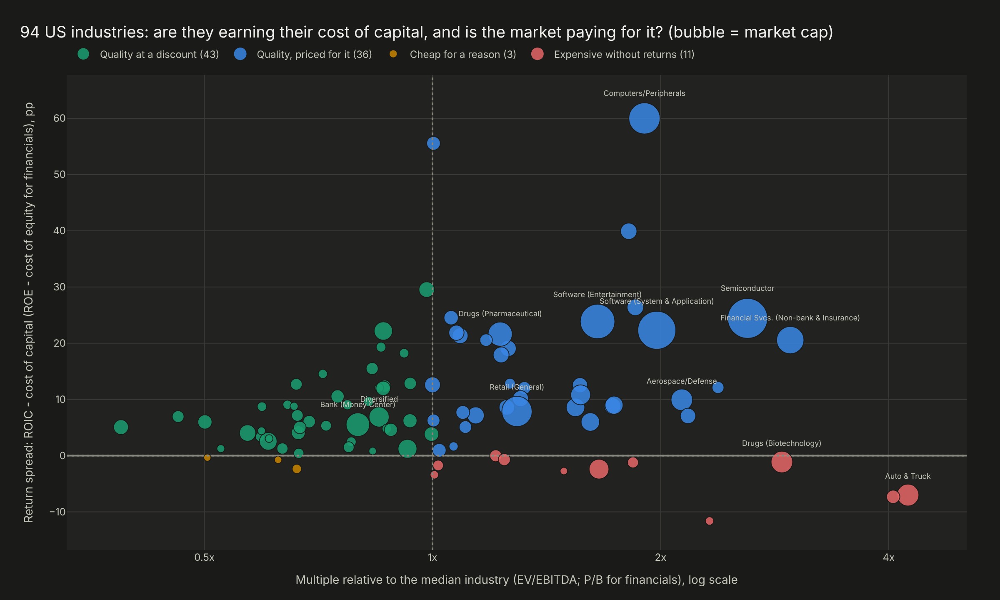
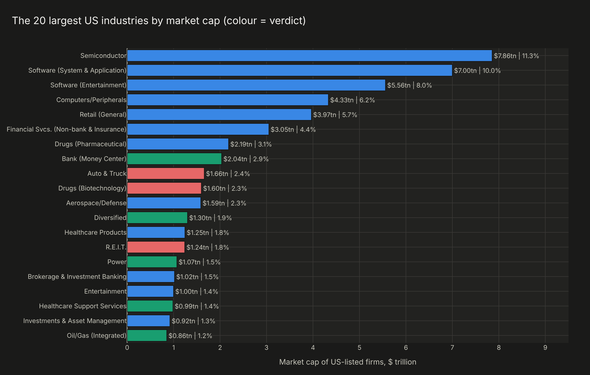

# Industry Tear Sheets

**Question:** can a whole industry be summarised on one page, well enough to decide quickly whether it deserves a closer look?

This project moves from companies to industries. It is a generator of one-page PDF tear sheets for all 94 US industries in Aswath Damodaran's January 2026 industry data, which covers 5,994 US-listed firms with $69.8tn of market cap. Each sheet answers one question first: **is this industry earning more than its cost of capital, and is the market already paying for it?** Below that answer come:

- the size of the industry: US-listed firms from Damodaran, plus a cited global market size where a public source gives one;
- valuation against the market and against other industries;
- profitability and returns;
- growth and risk;
- a map of all 94 industries with this one highlighted;
- the companies from my 85-company universe that belong to the industry, with their house rating from my [equity-research](https://github.com/tomasalarcon10/equity-research) project;
- the largest recent deals in it (announced or completed in 2025-2026), each with its value, date and source.

All numbers come from `outputs/metrics.json`.

## Key results

- **Verdicts.**
  - 43 industries earn more than their cost of capital and trade below the median industry multiple (*Quality at a discount*).
  - 36 earn it at a premium multiple (*Quality, priced for it*).
  - 3 are cheap without the returns (*Cheap for a reason*).
  - 11 are expensive without them (*Expensive without returns*).
  - Electronics (Consumer & Office) has negative EBITDA, so it gets no verdict.
- **Highest scores:** Cable TV (79), Precious Metals (78) and Hospitals/Healthcare Facilities (77). They have positive spreads, low relative multiples and low betas.
- **Lowest score:** Auto & Truck (11), which has a negative spread at more than 4x the median industry's EV/EBITDA.
- **Size is not quality.** The five largest industries are Semiconductor ($7.86tn), Software (System & Application) ($7.00tn), Software (Entertainment) ($5.56tn), Computers/Peripherals ($4.33tn) and Retail (General) ($3.97tn). All five sit in *Quality, priced for it*.
- **Featured: Semiconductor.** It is the largest US industry (11.3% of market cap).
  - ROIC is 35.0% against a 10.6% cost of capital, a +24.4 pp spread and the 94th percentile on returns.
  - EV/EBITDA is 35.0x, 2.61x the median industry.
  - Its beta of 1.52 is among the highest.
  - The score is 39/100 (#78 of 94): an excellent business at a full price.
  - Global market: $1.7tr in 2026 (IBISWorld, semiconductor and electronic parts). Largest recent deal: Skyworks / Qorvo, $22.0bn (2025).
- **Deals and market size.** 119 recent deals cover all 94 industries; 102 of them have a disclosed value of $1bn or more. 47 industries have a cited global market size; the other 47 sheets say it is not available rather than estimate it.

## Method

| Piece | Definition |
|---|---|
| Aggregates | Damodaran sums over the industry's firms, so ratios are market cap / net income, EV / EBITDA and so on; large firms weigh more |
| Return spread | ROIC (EBIT x (1 - tax) / invested capital) minus cost of capital; for the 9 financial industries, ROE minus cost of equity |
| Relative multiple | EV/EBITDA over the median non-financial industry (13.4x); for financials, P/B over the median financial industry (2.29x) |
| Verdict | spread above or below 0 x relative multiple above or below 1x |
| Ranks | share of industries with a strictly lower value (reversed for the multiple and beta), 0 to 100 |
| Score | average rank on returns (spread), growth (5-year revenue CAGR), value (relative multiple) and risk (beta) |

The companies are mapped to their Damodaran industry by my [dcf-valuation](https://github.com/tomasalarcon10/dcf-valuation) project; three companies without a DCF are mapped by hand in `src/collect.py`. Deal targets are mapped by hand in `data/deal_industry_map.json`.

**Recent deals** (`data/recent_deals.jsonl`): for each industry I looked for the largest deals announced or completed between January 2025 and November 2026. The sources are company press releases, SEC filings and press coverage (Reuters, Bloomberg Law, trade press). Each record keeps acquirer, target, date, value in US$ bn (blank when not disclosed or only reported in another currency, which is kept as reported), a note and the URL. Where an industry had no deal above $1bn in the sources reviewed (Tobacco, Trucking, Publishing & Newspapers, Real Estate (Development)), the sheet shows the largest smaller deals found and says so in the note. The sheet shows the three largest by value.

**Global market size** (`data/market_size.jsonl`): one figure per industry, from IBISWorld global industry reports (2026 market size; 2025 for courier services), Gartner's July 2026 worldwide IT spending forecast (software, IT services, communications services) or SEMI's July 2026 equipment forecast. Each record names the segment measured, because the source segment is often narrower than the Damodaran industry (for example beer for Beverage (Alcoholic)). Industries with no matching public figure are marked *not available*.

## Files

| Path | Contents |
|---|---|
| `src/tear_sheet.py` | The generator. Run `python tear_sheet.py "Semiconductor"` for one sheet, or with no argument for all 94 plus the book. |
| `reports/<industry>.pdf` | 94 one-page tear sheets |
| `reports/Industry_Tear_Sheets_Book.pdf` | Ranked index (score, verdict, size, spread, multiple, page) followed by every sheet |
| `excel/Industry_<industry>.xlsx` | The tear sheet in cells, with the Damodaran inputs for all 94 industries. Every multiple, return, rank, score and verdict is a formula; type another industry name in B2 and the sheet updates. A "Deals & market" sheet lists the industry's recent deals and market size with source links, and counts and sums them with formulas. Blue cells are inputs, black cells formulas, green cells links, yellow cells key outputs. |
| `excel/Industry_Database.xlsx` | All 94 industries with every derived metric, plus all 119 deals and every market size |
| `data/recent_deals.jsonl`, `data/market_size.jsonl` | Recent deals and global market sizes, one record per line, each with its source URL |
| `dashboard.html` | Pick an industry; re-weight the four score pillars to re-rank all 94; click any bubble on the map to load that industry |
| `data/raw/` | Damodaran DollarUS, wacc and histgr tables as published (January 2026) |
| `src/model.py`, `src/build_excel.py`, `src/charts.py` | Metrics and ranks (`outputs/metrics.json`), Excel, charts and dashboard |
| `outputs/charts/` | `industry_map`, `industry_scores`, `industry_space_3d`, `industry_size` (PNG and interactive HTML) |
| `tests/` | 221 pytest checks (`test_model.py`) and an Excel/Python parity script (`parity.py`) |

## Charts






## Reproduce

```bash
pip install -r requirements.txt
cd src
python collect.py        # joins the universe and the deals (needs the sibling repositories; outputs included)
python model.py
python tear_sheet.py
python build_excel.py    # recalculate in Excel or LibreOffice
python charts.py
cd .. && pytest -q tests/test_model.py && python tests/parity.py
```

## Verification

- **Excel vs Python.** `tests/parity.py` compares 1,880 values from the 94 recalculated workbooks with the Python model: multiples, returns, spread, relative multiple, the four ranks, score, verdict, and the deal counts, totals, largest deal and market size. There are no mismatches; the largest gap is 5e-15.
- **Data checks (pytest).**
  - All three source tables have 94 industries plus 2 totals.
  - Industry market caps sum to the market total.
  - Every ratio, rank, score and verdict reproduces.
  - The median relative multiple is exactly 1x in both groups.
  - Every industry has at least one recent deal; every deal and market-size record has an https source, a 2025-2026 date and a known industry.
- **Dashboard.** A headless-browser check loads the dashboard, switches industries and confirms the market size, deals and source links render with no script errors.

## Limitations

- **US firms only.** Damodaran also publishes global industry tables, but only as spreadsheets that this pipeline does not read.
- **Two kinds of size.** The Damodaran figures are US-listed firms only. The global market size comes from a different source and often measures a narrower or different segment (named on each record), so the two are not comparable line by line. Half the industries have no public global figure.
- **Deals are a curated sample, not a census.** They are the largest deals I found in public sources, not every deal in the industry; values are as reported (enterprise or equity value, as the source gives it).
- **Aggregate ratios are dominated by the largest firms.** Semiconductor is close to NVIDIA plus a long tail.
- **Damodaran's expected-growth columns can be extreme** for small or cyclical industries (for example Air Transport). The score therefore uses the historical revenue CAGR; expected EPS growth is shown for information.
- **Financial industries** report EBITDA and margins that are not meaningful; their sheets show n/m and use ROE and P/B instead.
- **Illustrative analysis, not investment advice.**

## Development process and use of AI

I chose to move this project from companies to industries, set the one question each page must answer and designed the verdict and score. Claude (Anthropic) was used as a research and coding assistant. It read the three Damodaran tables, searched public sources for the recent deals and market sizes (every figure kept with its URL), and wrote the generator, model, Excel, chart and dashboard code under my instructions. It also ran the tests, the Excel recalculation and parity check, and the browser check. I reviewed the sheets, the mappings and the wording before publishing.
